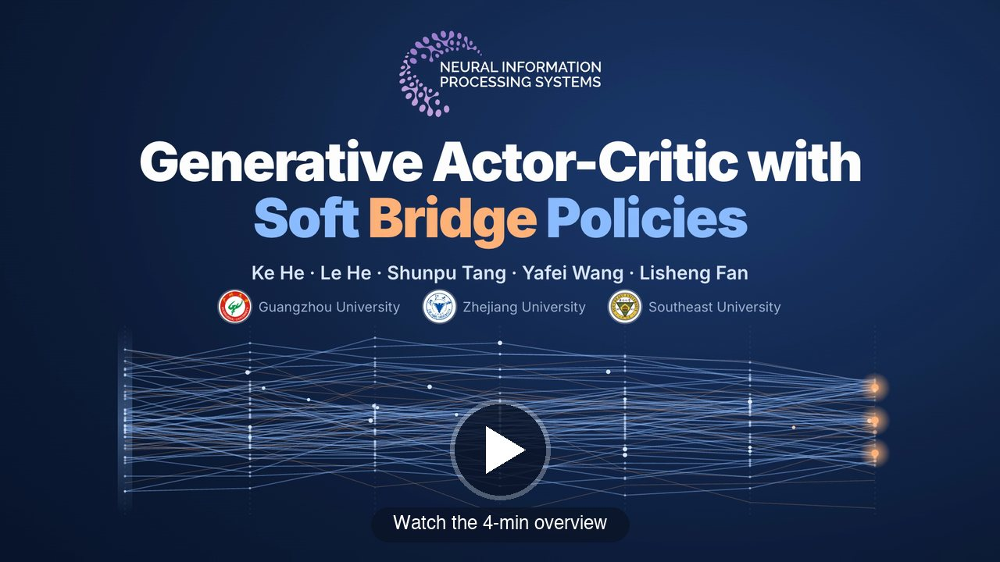
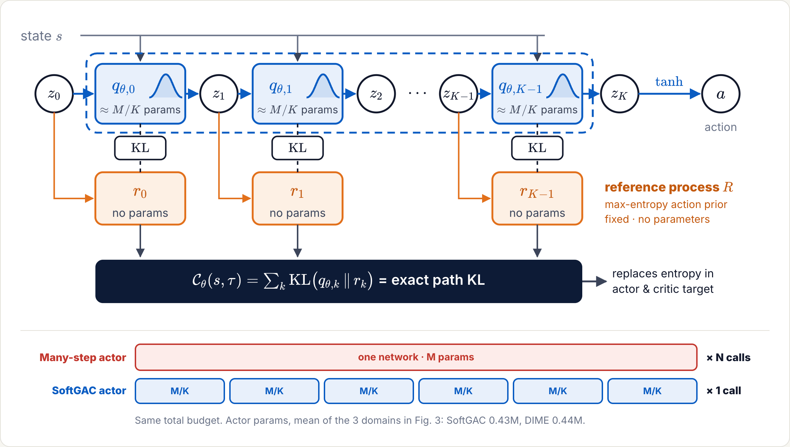
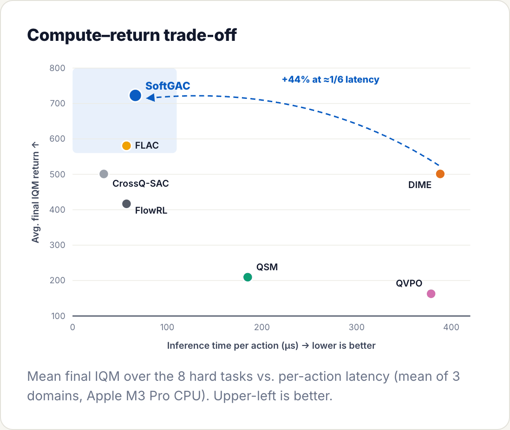
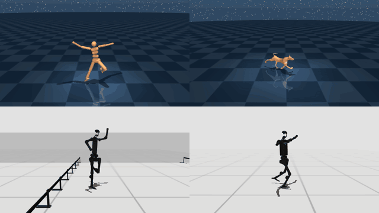

<h1 align="center">Generative Actor-Critic with Soft Bridge Policies</h1>

<p align="center">
  <b>NeurIPS 2026</b><br>
  Ke He · Le He · Shunpu Tang · Yafei Wang · Lisheng Fan
</p>

<p align="center">
  <a href="https://skypitcher.github.io/soft_gac_home/"></a>
  <a href="https://skypitcher.github.io/soft_gac_home/#video"></a>
  <a href="https://arxiv.org/abs/2605.08733"></a>
  <a href="preprint.pdf"></a>
  <a href="LICENSE"></a>
</p>

<!-- To play the overview video inline: edit this file on GitHub, drag softgac_teaser_en_github.mp4 (under 10 MB)
     onto the line below, and GitHub inserts a https://github.com/user-attachments/assets/... link that renders as a player.
     The thumbnail block after it can then be removed. -->

<p align="center">
  <a href="https://skypitcher.github.io/soft_gac_home/#video"></a><br>
  <sub>▶ Watch the 4-minute overview on the <a href="https://skypitcher.github.io/soft_gac_home/">project page</a> (or download the <a href="https://skypitcher.github.io/soft_gac_home/assets/videos/softgac_overview_en.mp4">MP4</a>).</sub>
</p>

Official **JAX** implementation of **SoftGAC**, a one-step generative actor for maximum-entropy RL. From the outside it is a single network call; inside, a short stochastic **soft bridge** of Gaussian layers makes the soft regularizer an **exact, analytical path KL**.

- **Soft:** principled MaxEnt, endpoint-equivalent to SAC. No entropy estimates or surrogates.
- **Fast:** one network call per action, with about the same number of parameters as the baselines.
- **Better:** +44% average return over the strongest many-step diffusion policy on 8 hard locomotion tasks, at about 1/6 of its latency.

<p align="center">
  <br>
  <sub>Open the box: <i>K</i> Gaussian transition layers share the parameter budget of one network, and their closed-form KLs to a max-entropy reference add up to the exact soft regularizer.</sub>
</p>

<p align="center">
  <br>
  <sub>Faster does not have to mean weaker.</sub>
</p>

<p align="center">
  <br>
  <sub>Trained SoftGAC policies: Humanoid Run, Dog Run, H1 Hurdle, H1 Run.</sub>
</p>

## Quick start

```bash
git clone https://github.com/skypitcher/soft_gac_jax.git
cd soft_gac_jax
./setup.sh                 # conda env "soft_gac": TPU JAX + CPU-only PyTorch
conda activate soft_gac
python main.py             # SoftGAC on dm_control/dog-run
```

- **CUDA 12 GPUs:** `REQ_FILE=requirements-gpu.txt ./setup.sh`
- **HumanoidBench** (`h1-*-v0` tasks): `./setup_humanoidbench.sh`, then `conda activate soft_gac_humanoidbench`

PyTorch is only used for Stable-Baselines3 replay buffers.

## Usage

```bash
# SoftGAC with K = 6 bridge layers
python main.py alg=soft_gac env_name=dm_control/dog-run alg.actor.hidden_size=256 alg.actor.num_layers=6
python main.py alg=soft_gac env_name=h1-hurdle-v0      alg.actor.hidden_size=512 alg.actor.num_layers=6

# Baselines: sac (CrossQ-SAC), dime, flowrl, flac, qsm, qvpo
python main.py alg=dime env_name=dm_control/humanoid-run

# 8 seeds in parallel (do not pass seed=...)
bash run_seeds_new.sh alg=soft_gac env_name=dm_control/dog-run
```

Any config value can be overridden as `key=value` (defaults in `configs/main.yaml` and `configs/alg/*.yaml`), for example `tot_time_steps=100000`, `wandb.enabled=true` or `checkpoint.enabled=false`. Runs default to 1M environment steps (3M for `dm_control/humanoid-run` and `h1-hurdle-v0`) and are saved to `results/<env>/<run-label>/<timestamp>_seedN/` with logs, `train.csv`, `eval.csv` and a code snapshot.

To time actor inference for all methods (compilation excluded): `python benchmark_actor_forward.py --batch-size 1`.

<details>
<summary><b>Occasional dead seeds on <code>humanoid-run</code></b></summary>

On TPU with `alg.train.num_particles=1`, we saw two dead seeds (6 and 7) on `dm_control/humanoid-run`; the other 11 tasks were unaffected across 8 seeds. More bridge particles lower the actor-update variance and fix it. This only affects training, not action generation:

```bash
python main.py alg=soft_gac env_name=dm_control/humanoid-run alg.actor.hidden_size=512 alg.actor.num_layers=6 alg.train.num_particles=32
python main.py alg=soft_gac env_name=dm_control/humanoid-run alg.actor.hidden_size=512 alg.actor.num_layers=6 alg.train.num_particles=4 alg.train.particle_scheme=antithetic
```
</details>

## Citation

```bibtex
@inproceedings{he2026softgac,
  title     = {Generative Actor-Critic with Soft Bridge Policies},
  author    = {He, Ke and He, Le and Tang, Shunpu and Wang, Yafei and Fan, Lisheng},
  booktitle = {Advances in Neural Information Processing Systems (NeurIPS)},
  year      = {2026},
  url       = {https://arxiv.org/abs/2605.08733}
}
```

We thank the Google TPU Research Cloud (TRC) program for providing compute resources. Released under the [MIT License](LICENSE).
