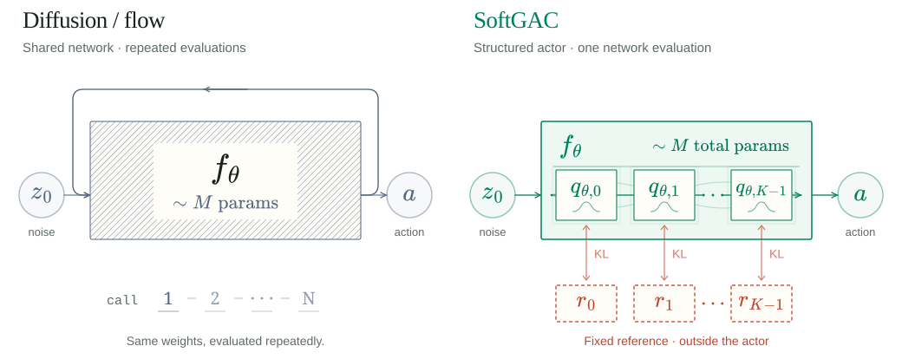

# Generative Actor-Critic with Soft Bridge Policies

**Accepted to NeurIPS 2026.**

Ke He, Le He, Shunpu Tang, Yafei Wang and Lisheng Fan

[](https://arxiv.org/abs/2605.08733)
[](preprint.pdf)
[](https://skypitcher.github.io/soft_gac_home/)
[](LICENSE)

Official **JAX** implementation of SoftGAC for **maximum entropy reinforcement learning (MaxEnt RL)**, with a focus on online learning and **continuous control**. Its stochastic feedforward actor generates each action in **one network evaluation**, using internal Gaussian bridge layers to compute an **analytical path-KL regularizer** for both actor and critic updates without estimating endpoint entropy. With comparable total actor parameter budgets, it achieves competitive or superior returns to strong **diffusion and flow-matching policies** at low inference cost.

The repository also includes a **Soft Actor-Critic (SAC)** baseline and benchmarks on the **DeepMind Control Suite (dm_control)** and **HumanoidBench**.

<p align="center">
  
</p>

<p align="center"><em>Generative policies for continuous control under comparable actor parameter budgets: iterative diffusion and flow-matching samplers versus SoftGAC's one-pass actor.</em></p>

## Quick Start

The default setup targets TPU JAX and CPU-only PyTorch. PyTorch is used only for Stable-Baselines3 replay-buffer tensors.

```bash
git clone https://github.com/skypitcher/soft_gac_jax.git
cd soft_gac_jax
./setup.sh
conda activate soft_gac
python main.py
```

The default command runs SoftGAC on `dm_control/dog-run`. To verify the accelerator backend:

```bash
python - <<'PY'
import jax
print(jax.__version__)
print(jax.default_backend())
print(jax.devices())
PY
```

## Installation

For CUDA 12 GPUs, install the GPU requirements explicitly:

```bash
REQ_FILE=requirements-gpu.txt ./setup.sh
conda activate soft_gac
```

For HumanoidBench tasks such as `h1-hurdle-v0`, use the dedicated environment:

```bash
./setup_humanoidbench.sh
conda activate soft_gac_humanoidbench
```

## Usage

SoftGAC examples:

```bash
python main.py alg=soft_gac env_name=dm_control/dog-run \
  alg.actor.hidden_size=256 alg.actor.num_layers=6

python main.py alg=soft_gac env_name=dm_control/humanoid-run \
  alg.actor.hidden_size=512 alg.actor.num_layers=6 \
  alg.train.num_particles=16

python main.py alg=soft_gac env_name=dm_control/humanoid-run \
  alg.actor.hidden_size=512 alg.actor.num_layers=6 \
  alg.train.num_particles=4 alg.train.particle_scheme=antithetic

python main.py alg=soft_gac env_name=h1-hurdle-v0 \
  alg.actor.hidden_size=512 alg.actor.num_layers=6
```


Available algorithms include SoftGAC (`soft_gac`), Soft Actor-Critic (SAC, `sac`) and the generative-policy baselines DIME (`dime`), FlowRL (`flowrl`), FLAC (`flac`), QSM (`qsm`) and QVPO (`qvpo`).

## Multi-Seed Runs

Run the default 8 seeds:

```bash
bash run_seeds_new.sh alg=soft_gac env_name=dm_control/dog-run
```

Do not pass `seed=...` manually. The launcher assigns one seed per subprocess.

## Configuration

Use `key=value` overrides from the command line. Global defaults are in `configs/main.yaml`, and per-algorithm defaults are in `configs/alg/*.yaml`.

```bash
python main.py tot_time_steps=100000 eval_freq=5000 wandb.enabled=false
python main.py alg.replay.mix_recent=false
python main.py alg.train.particle_scheme=antithetic
python main.py checkpoint.enabled=false
python main.py use_jit=false
```

Most tasks use 1M environment steps by default. Harder tasks such as `dm_control/humanoid-run` and `h1-hurdle-v0` use 3M unless explicitly overridden.

## Note on Occasional Dead Seeds

In rare cases, sensitivity to the combination of a high-dimensional, contact-rich locomotion task, hardware platform and random seed can produce one or two dead seeds, even though the remaining seeds learn normally. In our runs, this was observed for `dm_control/humanoid-run` seeds 6 and 7 on TPU with `alg.train.num_particles=1`. The other 11 benchmark tasks did not show this issue across 8 seeds with `num_particles=1`.

If this occurs, the practical fix is to reduce actor-update variance by increasing the number of bridge particles, for example from `np=1` to `np=32`, or by using a smaller antithetic setting such as `np4ant`, which uses 8 paired samples:

```bash
python main.py alg=soft_gac env_name=dm_control/humanoid-run \
  alg.actor.hidden_size=512 alg.actor.num_layers=6 \
  alg.train.num_particles=32

python main.py alg=soft_gac env_name=dm_control/humanoid-run \
  alg.actor.hidden_size=512 alg.actor.num_layers=6 \
  alg.train.num_particles=4 alg.train.particle_scheme=antithetic
```

These options only affect training-time actor updates. They do not change inference-time action generation. The run label records the particle setting, for example `np32` or `np4ant`.

## Outputs

Runs are saved under:

```text
results/<env-dir>/<run-label>/<timestamp>_seedN/
```

Each run writes `config.log`, `training.log`, `train.csv`, `eval.csv` and `code_snapshot.zip`. SoftGAC saves a final checkpoint when `checkpoint.enabled=true`. W&B is disabled by default and can be enabled with `wandb.enabled=true`.

Generated directories such as `results/`, `logs/`, `wandb/`, `checkpoint/` and `__pycache__/` are ignored by `.gitignore`.

## Citation

If you use SoftGAC in your research, please cite our NeurIPS 2026 paper:

```bibtex
@inproceedings{he2026softgac,
  title     = {Generative Actor-Critic with Soft Bridge Policies},
  author    = {He, Ke and He, Le and Tang, Shunpu and Wang, Yafei and Fan, Lisheng},
  booktitle = {Advances in Neural Information Processing Systems (NeurIPS)},
  year      = {2026},
  url       = {https://arxiv.org/abs/2605.08733}
}
```

## Acknowledgement

We thank the Google TPU Research Cloud (TRC) program for providing compute resources.
